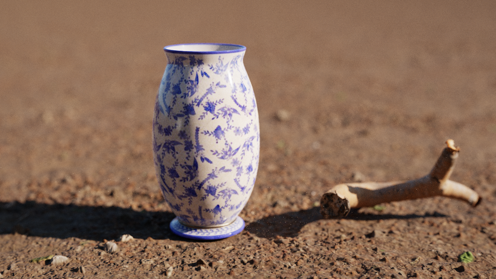

# Prism

一个从零写的 WebGPU 路径追踪器。没有 three.js 的渲染管线，没有第三方 BVH，
也没有预渲染的图 —— 页面上每一张图都是浏览器里现算出来的。



## 看什么

首页是画廊，每个场景一张卡片，点进去就是一页实时渲染的画面。访客不需要调任何参数 ——
构图、光照、材质都在场景里定好了。

| | |
|---|---|
| **荒地** | 一只青花瓷罐搁在夕阳下的砂土上，右下角躺着一根枯枝。地面铺到 72 m 外 —— 地表的起伏是真几何，每一颗石子都参与求交和阴影，不是法线贴图贴出来的假凹凸；景深是薄透镜算的，光圈半径按毫米给。 |

渲染页左上角返回画廊。渲染跑在 Worker 里，主线程只负责显示；左键拖拽旋转、
滚轮缩放、右键拖拽平移。

## 跑起来

```bash
npm install
npm run dev        # http://localhost:5173
```

需要支持 WebGPU 的浏览器：**Chrome / Edge 113+**，或 **Safari 18+**。
Firefox 需要 `dom.webgpu.enabled`。不支持时会落到静态页 —— 渲染出来的图和
一段说明，至少不会白屏。

## 实现了什么

**求交**
- 两级 BVH（TLAS / BLAS），CPU 构建后扁平化成一维 buffer，GPU 上迭代遍历
- Möller–Trumbore 三角形求交，局部空间求交保持 `t` 在实例缩放时不变

**光照**
- NEE：环境图按亮度 CDF 重要性采样，阴影射线可见就直接取该方向的辐亮度
- MIS：BSDF 采样与光源采样用 power heuristic 混合
- 俄罗斯轮盘赌：第 4 次弹射后按存活概率终止
- 渐进累积：每帧累加 1 spp，相机和参数不动就不重置

**其它**
- 环境图重要性采样（2K EXR）
- glTF 2.0 导入（`.gltf` 外链资源、`.glb` 单文件都行），
  画面里那只瓷罐和枯枝就是这么进来的
- 薄透镜景深：光圈半径 + 对焦距离，都是米；主射线从光瞳圆盘上一点出发，
  指向焦平面上的同一个点
- 位移贴图烘成真几何（细分 + 顶点位移），进 BVH 参与求交和阴影；演化后的材质
  不带位移字段，着色器不知道它存在
- 材质贴图走 `texture_2d_array`：漫反射 / 法线 / 粗糙度 / 环境光遮蔽四个数组，
  各自带完整 mip 链；glTF 的 metallicRoughness 打包图原样进粗糙度数组，
  G 通道读粗糙度、B 通道读金属度（Poly Haven 的 arm 图同一套排列）
- 每帧只采屏幕的一部分像素，dispatch 量由 GPU 实测耗时自适应；顺序表保证
  每一轮正好覆盖每个像素一次，所以累加平均的分母不需要逐像素存储

## 没做什么

写清楚边界比列功能表有用：

- **glTF 只吃三角形和四种贴图**。Draco / meshopt 压缩、蒙皮、动画、morph 都不支持
  （Draco 会明确报错）
- **不支持透明 / alpha 切边**。树叶、纱帘这类靠 alpha 裁形的模型会渲染成实心片
  （材质 IR 里连 alpha 字段都不留，要做得从 glTF 导入一路加回来）
- **没有透射 / 玻璃**。这是路径追踪最能打的画面，排在下一个
- **BVH 是 16 桶 × 三条轴的分桶 SAH**；深度超过 40 层时退回中位数切分，
  给 shader 的 64 层遍历栈留余量。叶子最多 2 个图元
- **没有自发光 / 显式光源类型**。照明只有环境图，模型自带的 emissive 材质会被忽略

## 结构

依赖方向单向，越往下越不认识上面的东西：

```
app/     业务层：路由、画廊、渲染页、降级页 + scenes/ 场景内容
         —— 主线程只 import core/prism 与 scenes/catalog
core/    渲染器：门面 + Worker 组合根 + 引擎 + IR 生产 + IR
         prism.ts / worker.ts / protocol.ts / rpc-client.ts / handles/   门面与组合根
         loaders/    image / texture / gltf —— 外部资产 → IR
         geometry/   MeshBuilder 与 Instance 摆位（程序化几何 → IR）
         engine/     context / camera / frame（含 path-tracing）/ loop /
                     background（envMap + 亮度 CDF）/ display / model
         ir/         Image / PBRMaterial（含 .blend 解析）/ Mesh / Instance /
                     Scene / CameraView
math/    向量、矩阵、颜色（app 与 core 共用）
```

光追完全跑在 Worker 里：`Prism.create()` 起一个 Worker、要一个独立 `GPUDevice`，
主线程不碰 GPU，只通过 `camera.listen()` 接收 `ImageBitmap`。`core/worker.ts` 是
组合根：唯一同时 import 引擎、导入器和场景清单的地方。IR 与编译产物分离：`ir/`
下的 `instance.ts` / `mesh.ts` 是场景描述，`model/model.ts` 里的 buffer 是编译结果。

约 8800 行 TypeScript + WGSL + CSS。

### 加一个场景

`app/scenes/manifest.ts` 是唯一清单：写一个 `createXxx(): Promise<Scene>` 构建器
（`app/scenes/` 里单独一个文件），在 `SCENES` 里加一条，在 `catalog.ts` 里
加卡片元数据，再放一张 `assets/gallery/<key>.png` 当封面。
路由、画廊、降级页都会自动带上它。

## 场景从哪来

模型、贴图、环境图都来自 **Poly Haven**（CC0）：模型和材质下载后放进
`assets/model/`、`assets/textures/`，环境图（EXR）放进 `assets/env/`。
有些场景是几个模型拼起来的，摆放和取景写在 `app/scenes/` 里 ——
引擎不认识具体的模型，只认 `Scene`。

地面这类大面积几何由代码生成 —— `core/geometry/mesh-builder.ts` 里的 `MeshBuilder`
铺平面，位移贴图挂在材质上：`Mesh.evolve()` 在编译时把带图的三角形细分成真几何、
顶点抬起、法线按高度场重算，那张图进 GPU 之前就被消耗掉了。

## 许可

MIT
