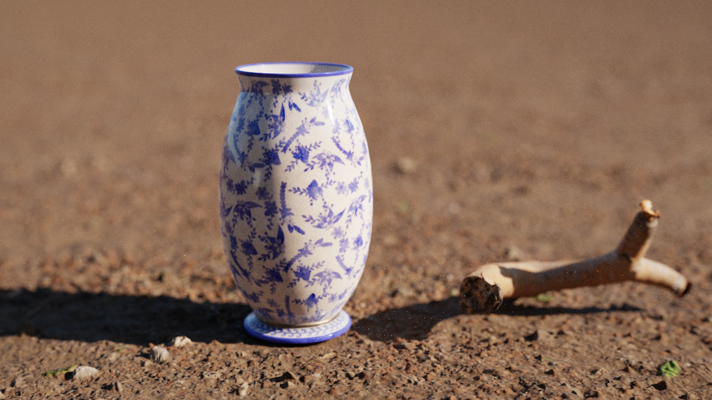

# Prism

一个从零写的 WebGPU 路径追踪器。没有 three.js 的渲染管线，没有第三方 BVH，
也没有预渲染的图 —— 页面上每一张图都是浏览器里现算出来的。



## 看什么

首页是画廊，每个场景一张卡片，点进去就是一页实时渲染的画面。访客不需要调任何参数 ——
构图、光照、材质都在场景里定好了。

| | |
|---|---|
| **荒地** | 一只青花瓷罐搁在夕阳下的砂土上，右下角躺着一根枯枝。地面铺到 72 m 外 —— 地表的起伏是真几何，每一颗石子都参与求交和阴影，不是法线贴图贴出来的假凹凸；景深是薄透镜算的，光圈半径按毫米给。 |

渲染页左上角返回画廊，左下角 HUD 是实时统计（每帧采样数、GPU 耗时、帧率），
按 `S` 保存当前截图。

## 跑起来

```bash
npm install
npm run dev        # http://localhost:5173
```

需要支持 WebGPU 的浏览器：**Chrome / Edge 113+**，或 **Safari 18+**。
Firefox 需要 `dom.webgpu.enabled`。不支持时会落到静态页 —— 渲染出来的图和
一段说明，至少不会白屏。

## 实现了什么

**求交**
- 两级 BVH（TLAS / BLAS），CPU 构建后扁平化成一维 buffer，GPU 上迭代遍历
- Möller–Trumbore 三角形求交，局部空间求交保持 `t` 在实例缩放时不变

**光照**
- NEE：环境图按亮度 CDF 重要性采样，阴影射线可见就直接取该方向的辐亮度
- MIS：BSDF 采样与光源采样用 power heuristic 混合
- 俄罗斯轮盘赌：第 4 次弹射后按存活概率终止
- 渐进累积：每帧累加 1 spp，相机和参数不动就不重置

**其它**
- 环境图重要性采样（2K EXR）
- glTF 2.0 导入（`.gltf` 外链资源、`.glb` 单文件都行），
  画面里那只瓷罐和枯枝就是这么进来的
- 薄透镜景深：光圈半径 + 对焦距离，都是米；主射线从光瞳圆盘上一点出发，
  指向焦平面上的同一个点
- 位移贴图烘成真几何（细分 + 顶点位移），进 BVH 参与求交和阴影；演化后的材质
  不带位移字段，着色器不知道它存在
- 材质贴图走 `texture_2d_array`：漫反射 / 法线 / 粗糙度 / 环境光遮蔽四个数组，
  各自带完整 mip 链；glTF 的 metallicRoughness 打包图原样进粗糙度数组，
  G 通道读粗糙度、B 通道读金属度（Poly Haven 的 arm 图同一套排列）
- 每帧只采屏幕的一部分像素，dispatch 量由 GPU 实测耗时自适应；顺序表保证
  每一轮正好覆盖每个像素一次，所以累加平均的分母不需要逐像素存储

## 没做什么

写清楚边界比列功能表有用：

- **glTF 只吃三角形和四种贴图**。Draco / meshopt 压缩、蒙皮、动画、morph 都不支持
  （Draco 会明确报错）
- **不支持透明 / alpha 切边**。树叶、纱帘这类靠 alpha 裁形的模型会渲染成实心片
  （材质 IR 里连 alpha 字段都不留，要做得从 glTF 导入一路加回来）
- **没有透射 / 玻璃**。这是路径追踪最能打的画面，排在下一个
- **BVH 是最长轴中位数切分，不是 SAH**。这个规模下实测没差别，换桶装 SAH
  只影响 `src/engine/model/bvh.ts` 一个函数
- **没有自发光 / 显式光源类型**。照明只有环境图，模型自带的 emissive 材质会被忽略

## 结构

依赖方向单向，越往下越不认识上面的东西：

```
app/     路由、画廊、渲染页、降级页
config/  构建 IR：场景清单、场景构建器、资产导入器（glTF / 图像 / 贴图）、几何工具
engine/  拿 IR 建可渲染的东西（不按 CPU / GPU 分工）：context / camera /
         frame（含 path-tracing）/ loop / background（envMap + 亮度 CDF）/
         display（色调映射 + 暗角 + 颗粒）/ model（model.ts 一条链编译到底：
         布局 → 节点表 → 打包 → 上传；bvh.ts 建 BLAS；材质子系统在 model/material/）
ir/      IR 定义：Image / PBRMaterial / Mesh / Instance / Scene / CameraView
math/    向量、矩阵、颜色
```

`engine/` 里仍然是分层单向的：编排 → GPU 资源 → 场景 IR。IR 与编译产物分离：
`ir/` 下的 `instance.ts` / `mesh.ts` 是场景描述，`model/model.ts` 里的 buffer 是编译结果，
所以换掉渲染后端不用动场景代码。

约 8800 行 TypeScript + WGSL + CSS。

### 加一个场景

`src/config/config.ts` 是唯一清单：写一个 `createXxx(): Promise<Scene>` 构建器
（单独一个文件），在 `SCENES` 里加一条，再放一张 `assets/gallery/<key>.png` 当封面。
路由、画廊、降级页都会自动带上它。

## 场景从哪来

模型、贴图、环境图都来自 **Poly Haven**（CC0）：模型和材质下载后放进
`assets/model/`、`assets/textures/`，环境图（EXR）放进 `assets/env/`。
有些场景是几个模型拼起来的，摆放和取景写在 `src/config/` 里 ——
引擎不认识具体的模型，只认 `Scene`。

地面这类大面积几何由代码生成 —— `src/config/mesh-builder.ts` 里的 `MeshBuilder`
铺平面，位移贴图挂在材质上：`Mesh.evolve()` 在编译时把带图的三角形细分成真几何、
顶点抬起、法线按高度场重算，那张图进 GPU 之前就被消耗掉了。

## 许可

MIT
